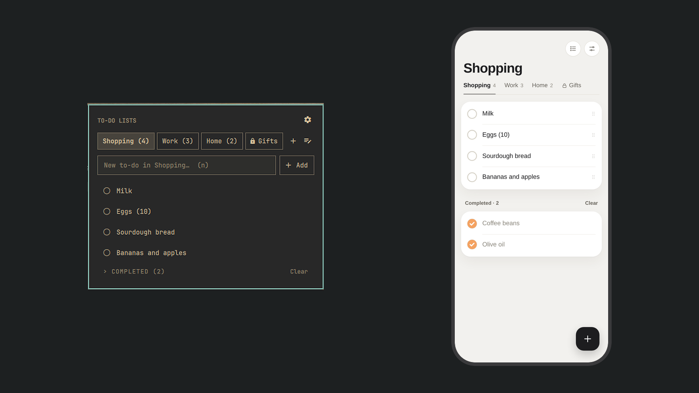
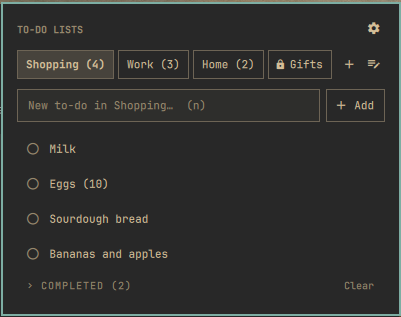
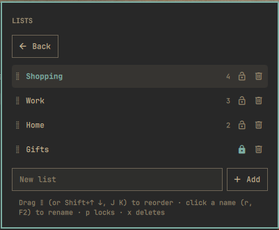
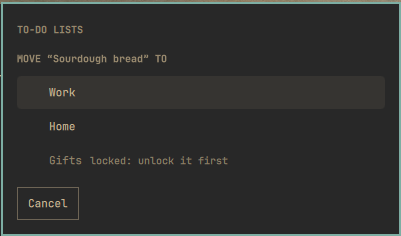
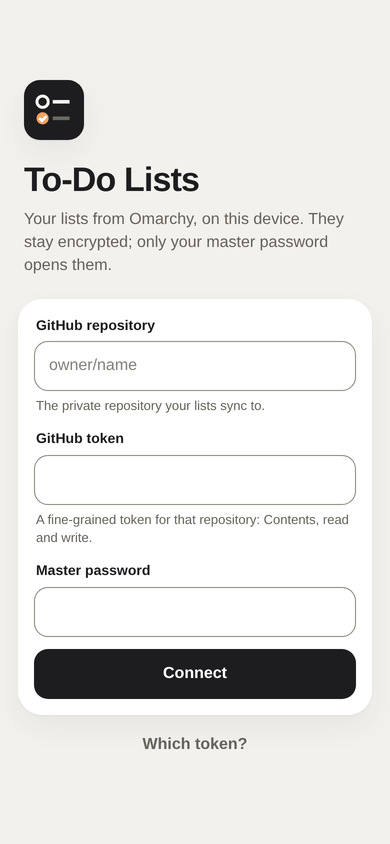
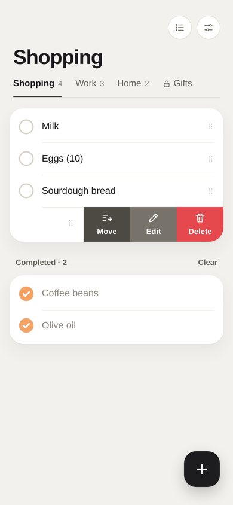
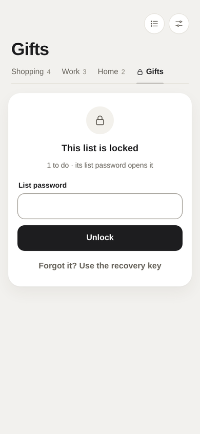
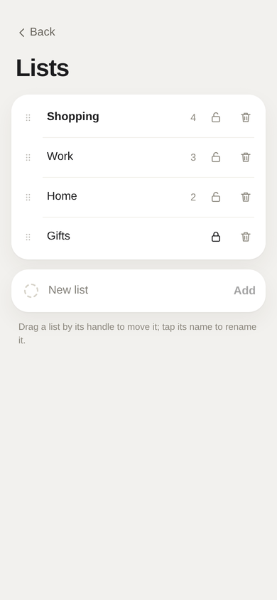
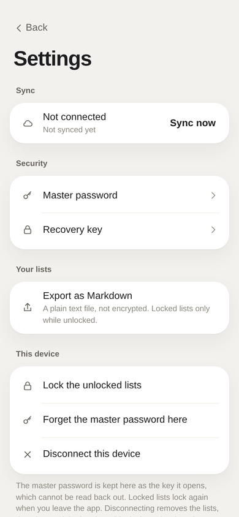

# To-Do Lists

To-do lists in the Omarchy bar, each in a tab of its own: shopping, work, anything you name. They are end-to-end
encrypted with your master password, a list can have a password of its own, and they sync through a private
GitHub repository to your phone, where a small web app shows the same lists, on iPhone and Android, offline too.



## Where your data lives

Only on your own devices, and in your own private GitHub repository:

- **Your computer**: `~/.local/share/omarchy-todo-lists/todo-lists.enc`, encrypted.
- **Your phone**: inside the web app on the phone, encrypted.
- **Your private GitHub repository** (only if you set up sync): the same encrypted file, which carries changes
  between your devices. GitHub sees an encrypted file, never a list, a to-do or a password.

There is no server, cloud service or account of this project. Nothing is sent anywhere else: no analytics,
no tracking. Without sync, nothing leaves your computer at all. The web app at todo.dobrovodsky.dev is only
its code (static files on GitHub Pages); your lists never pass through it.

## Install

Requires Omarchy 4.

```bash
omarchy plugin add https://github.com/MaNi4/omarchy-todo-lists.git --enable
```

Open it from the bar, or with **Super + R**. The first time, choose a master password (12 characters or more).
You then get a **recovery key**: keep it in your password manager. It is the one way back in if you forget the
master password.

## Remove

```bash
omarchy plugin remove mani4.todo-lists
```

Your lists stay, encrypted, in `~/.local/share/omarchy-todo-lists/`, and the settings in
`~/.config/omarchy/extensions/todo-lists.json`; delete them if you do not want to keep them. The master password's
key is in your keyring under "To-Do Lists (Omarchy)".

## Using it

- **Tabs** are your lists. **+** next to them adds a list; the list icon opens **Lists**, where you rename,
  reorder (drag the handle, or Shift + arrows), lock and delete them.
- **Add** a to-do in the field and press Enter. **Click** a to-do to tick it (it waits a moment, so a slip can be
  undone); the pencil edits it, the arrow moves it to another list, the cross removes it; drag it to reorder it.
- **Completed** to-dos fold away under their list; **Clear** removes them.
- A removed, cleared or moved to-do can be brought back for a few seconds: **Undo** under the list, or `u`.
- **Export** (Settings › Export) writes your lists to `~/Documents` as a Markdown file, a check box per to-do:
  plain text, to keep or read anywhere. A locked list is included only while it is unlocked.
- The keyboard works throughout: arrows to move, Space to tick, `n` to add, `e` to edit, `t` to move to another
  list, `x` to remove, `u` to undo, Shift + arrows to reorder, `m` for Lists, `s` for the settings.
  Settings › Keyboard lists every key.

### Locked lists

A list can have a **list password** of its own (Lists › its lock). Its to-dos are encrypted again with it and stay
hidden until it is typed; they lock again when the panel closes. A forgotten list password opens with the recovery
key. Any list password works on the phone too.

### The shortcut

**Super + R** opens and closes the panel. The plugin never takes a key something else uses: if Super + R is taken,
you get a notification instead; click it to choose a free key (Settings › Shortcut), or type your own, like
`super + alt + t`. The choice is kept in `~/.config/omarchy/extensions/todo-lists.json`.

## Your lists on your phone

The lists live on your devices; a private GitHub repository only carries one encrypted file between them. GitHub
never sees a list, a to-do or a password. It takes four steps, once.

### 1. A private repository for the data

On github.com: **New repository**, any name (for example `todo-lists-data`), **Private**. Nothing else is needed;
it can stay empty.

### 2. A token for each device

The plugin and the phone each need a token that can write that one repository, and nothing else:

1. github.com › your picture › **Settings** › **Developer settings** › **Personal access tokens** ›
   **Fine-grained tokens** › **Generate new token** (or open https://github.com/settings/personal-access-tokens/new).
2. **Token name**: `todo-lists computer` (and later `todo-lists phone`).
3. **Expiration**: as you like.
4. **Repository access**: **Only select repositories** › your data repository.
5. **Permissions** › **Repository permissions** › **Contents**: **Read and write**. (Metadata, read-only, comes
   with it.) Nothing else.
6. **Generate token**, and copy it: GitHub shows it only once.

Make one token per device, so you can revoke one (a lost phone) and keep the others.

### 3. Connect the plugin

Panel › settings (the gear, or `s`) › **Sync**: the repository as `owner/name`, and the computer's token ›
**Connect**. The encrypted file `todo-lists.enc` appears in the repository. From then on the plugin syncs when you
open the panel, a few seconds after each change, and every five minutes. The token is kept on the computer,
encrypted with your lists' key.

### 4. Your phone

1. Open **https://todo.dobrovodsky.dev**: on **iPhone in Safari**, on **Android in Chrome**.
2. Install it as an app:
   - **iPhone**: the Share button › **Add to Home Screen** (keep "Open as Web App" on) › **Add**.
   - **Android**: ⋮ › **Install app** (or **Add to Home screen**).
3. Open it **from the home screen** (not the browser tab: the home-screen app keeps its data for good), and
   connect: the repository, the phone's token, and your master password.

The phone has the same tabs, locked lists and recovery as the panel. It works offline and syncs when it is online;
changes made on both sides meanwhile are merged, one field at a time, so nothing is lost. The web app's code is
at [MaNi4/todo-lists-web](https://github.com/MaNi4/todo-lists-web); it is the code only, your lists never pass
through that site.

### Another computer

Install the plugin there, and on its first screen choose **I have them on GitHub…**: the repository, a token of its
own, and your master password.

## Passwords

| | What it opens | When you type it |
|---|---|---|
| **Master password** | Everything | Once per device; the keyring (and the phone) remember its key. Change it in Settings › Master password; other devices go on without asking. |
| **Recovery key** | Everything, and any locked list | Only if a password is forgotten. Shown once; Settings › Recovery key makes a new one. |
| **List password** | One locked list | Each time you open that list. |

Nobody can open your lists without them, and neither can you: there is no reset by email.

## Screenshots

| | | |
|---|---|---|
|  |  |  |

| | | | | | | |
|---|---|---|---|---|---|---|
|  |  |  |  |  |  |  |

## How it works

- `bin/todo-lists` (Python) keeps the lists: it is the only one that reads and writes the file, holds the keys while
  the lists are open, syncs with GitHub (the REST API, with the token in the Authorization header), and prints the
  lists as JSON lines. `Service.qml` runs it once for the shell and binds the shortcut (`Hotkey.js`); `Panel.qml` is the
  panel on each monitor's bar, and sends it commands on its stdin. What the panel decides (the list in view,
  ticking, passwords, the settings, the keyboard, the tabs) is in `Model.js`, which has no QML in it.
- The file is one envelope: the lists sealed with AES-256-GCM under a random data key, which the header wraps with
  the master password (Argon2id, 64 MiB) and for the recovery key (P-256). The header is signed with a key from the
  data key, so a header changed on GitHub is refused. A locked list has a key of its own, wrapped with its list
  password. See [SECURITY.md](SECURITY.md).
- The lists are records with a time per field, and deletions are kept for 90 days, so two devices' changes merge.

## Requirements

- Omarchy 4.
- `python-cryptography`: `omarchy pkg add python-cryptography` if it is missing (the panel says so).
- `argon2`: comes with Omarchy.
- A keyring (gnome-keyring, as in Omarchy) to remember the master password's key; without one it is asked after
  each restart.

## Tests

```bash
python3 -m unittest discover -s tests   # the store, the encryption, syncing (with a fake GitHub), the web app's file
node tests/run.js                        # Model.js and Hotkey.js: the panel's decisions and the shortcut
```

`tests/fixtures/web-v3.json` is a file the web app wrote: the plugin must open it, as the web app's tests open one
the plugin wrote.

## License

MIT
